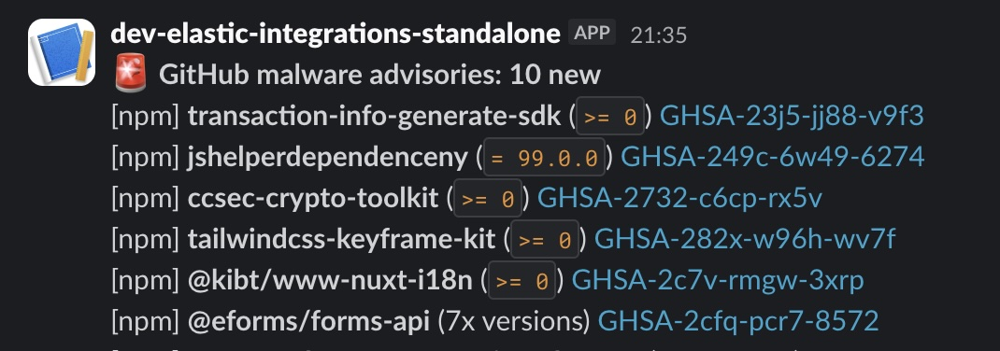
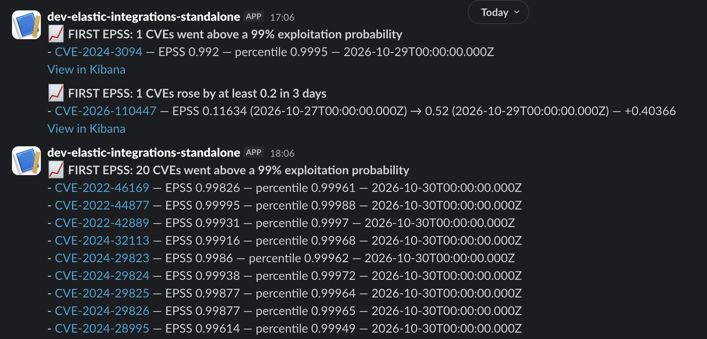

+++
title = "Test the Elastic data path end to end locally before production"
date = 2026-10-30
summary = "Test Elastic Agent integrations, ingest pipelines, and detection rules locally with elastic-package, OpenTofu, and Docker before they reach production."
keywords = ["Elastic Agent", "Elastic integrations", "elastic-package", "OpenTofu", "Kibana detection rules", "ES|QL", "EPSS", "GitHub Security Advisories"]
featureAlt = "Open paint buckets in many colors seen from above"
slug = "testing-elastic-data-path-locally"
draft = false
+++

I maintain Elastic Agent integrations that bring [security data into Elasticsearch](https://www.elastic.co/blog/how-infosec-uses-elastic-stack-vulnerability-management). Some are native, such as Qualys, HackerOne, and Snyk, and others are custom. Even the native ones need custom ingest pipelines to fit our needs. When something broke in that custom layer, troubleshooting was slow: production access was limited, and building a local environment that matched production took more time than the fix itself.

So I built a new version of my [standalone repository](https://github.com/clement-fouque/elastic-integrations-standalone). Two commands start a local Elastic stack and deploy an integration together with the resources and rules around it. This post explains that design and shows two real examples: a Slack alert when GitHub publishes a new malware advisory, and one when the exploit prediction score of a CVE rises quickly.


## Why package tests are not enough

Testing an integration package on its own is easy. [`elastic-package`](https://github.com/elastic/elastic-package) can start a stack and run the package's system tests. That tells me the package works, but it does not tell me what my environment does with the data.

In production, the data path has more parts than the package:

- the integration version we run
- custom ingest pipelines that rename, enrich, or drop fields
- component templates that override mappings
- lifecycle policies that control retention
- transforms that read the data stream and build summary or latest indices
- detection rules and connectors that act on the data

A bug can come from any of these parts, or from how they interact. I wanted all of them on my laptop, deployed from the same kind of files I use for production.

## How the repository is organized

### One folder per integration

Each integration has a folder under `integrations/` with its Agent policy and its resources, and an [OpenTofu](https://opentofu.org/) root under `infrastructure/` that deploys them. Here is the layout from the repository README:

```text
.
├── Makefile                         # Deployment targets
├── .env.example                     # Environment variables template
├── .env                             # Your environment variables (create from .env.example)
├── scripts/
│   └── with-env.sh                  # Loads .env for a single command
├── infrastructure/
│   ├── modules/integration/         # Shared OpenTofu module
│   └── <integration_name>/          # OpenTofu root, one per integration
└── integrations/
    └── <integration_name>/
        ├── compose.yml              # Agent container
        ├── data.compose.yml         # Optional: escli service that loads data before the Agent
        ├── data/                    # Optional: data.ndjson loaded before the Agent starts, and its README
        ├── elastic-agent.yml        # Elastic Agent configuration
        ├── terraform.tfvars         # Fleet package versions
        ├── pipelines/               # Optional: ingest pipelines
        ├── component_templates/     # Optional: component templates
        ├── index_templates/         # Optional: index templates
        ├── ilm/                     # Optional: ILM policies
        ├── data_streams/            # Optional: data streams
        ├── transforms/              # Optional: transforms
        ├── detection_rules/         # Optional: Kibana Security detection rules
        └── connectors/              # Optional: Kibana connectors
```

The folder names match the resource types. A shared OpenTofu module reads every JSON file in these folders and deploys it, so adding a resource means adding a file. The optional `data.compose.yml` file and `data/` folder load documents before the Agent starts. The EPSS example below uses them.

### Two commands

The first command starts the stack. It uses `elastic-package` to stop any running stack and start Elasticsearch and Kibana 9.5.5. Add `version=<x.y.z>` to test another version. I could use [start-local](https://github.com/elastic/start-local) instead, but `elastic-package` is the recommended tool to build integrations, and I already use it when I develop new ones. Using the same tool for both keeps one setup to learn and maintain.

```sh
make stack-restart
```

The second command deploys one integration:

```sh
make deploy-local INTEGRATION=github_security_advisories
```

It runs OpenTofu `init`, `plan`, and `apply`, loads the integration's test data if it has any, then restarts the [standalone Elastic Agent](https://www.elastic.co/docs/reference/fleet/install-standalone-elastic-agent) with Docker Compose. OpenTofu installs the integration package, then deploys the Elasticsearch resources and the Kibana rules and connectors.

I usually run both commands one after the other to start from a clean environment. They stay separate because I do not always need a new stack. When I only change a rule or a template, I redeploy the integration and keep the stack running.

### Why JSON

OpenTofu handles the deployment order and the state. The resources themselves stay in JSON because Elasticsearch and Kibana speak JSON. When I read a component template or export a detection rule from production, I get JSON in the same shape as the file in the repository. I can compare the two, or copy a production resource into the repository to reproduce a problem.

With Terraform blocks, every comparison would need a translation from HCL to the API format. That translation is easy to get wrong during an incident. Dashboards are the exception, because they need more provider logic, so they stay as OpenTofu code (unless I find a better solution).

This is also where the value of configuration as code becomes obvious. When the configuration is versioned and reviewed in plain JSON, it is easy to look at a diff before pushing it, ask an LLM to explain a change, or manually compare the local and production definitions. Because the test environment is disposable, I can test the same configuration again and again without wasting time creating or cleaning up a fragile environment.


## Example: a Slack alert for new malware advisories

A malware advisory in the [GitHub Advisory Database](https://github.com/advisories) describes a package version that contains malicious code, such as a compromised npm release. A security team then needs to know whether it uses that package. Even without dependency data in the stack, a Slack notification is a good first step: it gives the team a signal to investigate and check whether the package is in their environment.

The [GitHub integration](https://www.elastic.co/docs/reference/integrations/github) already collects advisories into `logs-github.security_advisories-default`. The Agent policy runs three streams (reviewed, unreviewed, and malware), and all three write to the same data stream. I needed a detection rule and a Slack connector.

### The final detection rule

The GitHub Agent polls every 24 hours and ingests the full advisory list each time, so the rule needs to avoid repeating the same alert on the same advisory. It also needs to ignore old advisories on the first run. The final solution is a new terms rule that alerts only when a new `ghsa_id` appears in the last 14 days and only when the advisory was published in the last 7 days. Those numbers are arbitrary, but they are easy to adjust in the JSON if the team wants a longer or shorter window. This design is tied to the full ingest that the integration does today. When it supports incremental ingest, I will adapt the polling interval and the rule.


**Tip:** you do not have to wait for the next scheduled run to test a rule. In Kibana, disable the rule and enable it again. The rule runs right away, and you see the alert and the Slack message within seconds.


Here is the exact rule definition from `detection_rules/github-malware-advisory-published.json`:

```json
{
  "type": "new_terms",
  "name": "GitHub Malware Advisory Published",
  "index": ["logs-github.security_advisories-default"],
  "language": "kuery",
  "query": "github.security_advisory.type:\"malware\" and github.security_advisory.published_at >= \"now-7d\"",
  "new_terms_fields": ["github.security_advisory.ghsa_id"],
  "history_window_start": "now-14d",
  "interval": "5m",
  "from": "now-6m",
  "to": "now",
  "timestamp_override": "event.ingested"
}
```

The rule's `actions` block sends the message through the Slack connector defined in `connectors/github-security-advisories-slack.json`. The webhook URL is not in that file. It comes from a Git-ignored `.env` file and reaches Kibana through a write-only OpenTofu attribute, so it is not stored in the OpenTofu state.



### Two ES|QL rules to test the ingestion path

The malware rule was the main example, but I also wanted to test ES|QL rules. I added two ingestion health rules to cover the cases where the Agent no longer collects advisories. One alerts when GitHub or the ingest pipeline returns an error. The other alerts when one advisory stream ingests nothing for 26 hours.

## Example: a Slack alert when an EPSS score rises

The [Exploit Prediction Scoring System (EPSS)](https://www.first.org/epss/) from FIRST gives each CVE a probability of exploitation in the wild in the next 30 days. FIRST publishes a new snapshot every day, so the score of a CVE changes over time. A CVE whose score jumps in a few days deserves a second look, even when the score is still moderate. I wanted a Slack alert when a score rises by at least 0.2 in 3 days.

The [FIRST EPSS integration](https://www.elastic.co/docs/reference/integrations/first_epss) collects each daily snapshot into `logs-first_epss.vulnerability-default`. The `first_epss` folder follows the same layout as the GitHub one, with an ILM policy, a Slack connector, and an ES|QL rule.

To detect a rise, the rule compares snapshots from different days. A fresh local stack has only the snapshot the Agent collects on its first run, so the rule has nothing to compare. Waiting 3 days for real data is not a test loop.

### Loading data before the Agent

So the repository can now load documents into the data stream before the Agent starts. The integration has a `data/data.ndjson` file in bulk format and a `data.compose.yml` file that defines a one-shot [escli](https://github.com/Anaethelion/escli-rs) service. escli is still alpha, and its image is published for `linux/amd64` only, so it runs emulated on Apple Silicon. In `compose.yml`, the Agent waits for that service:

```yaml
first_epss:
  # ...
  depends_on:
    first_epss_data:
      condition: service_completed_successfully
```

`make deploy-local` keeps the order: OpenTofu installs the templates and pipelines, escli loads the documents, then the Agent starts. If a document fails, the Agent does not start. The documents are already processed, so escli skips the integration's ingest pipeline.

I built the file by exporting a few real CVEs with `escli utils dump` from a stack that already ran the integration, then I edited the dates and scores. Two CVEs cover both sides of the 0.2 threshold:

| CVE | Scores in the file | Expected result |
| --- | --- | --- |
| CVE-2026-110447 | 0.11634, then 0.52 two days later | Rises by 0.40: alert |
| CVE-2023-31719 | 0.26032, then 0.35 two days later | Rises by 0.09: no alert |

### The ES|QL rule for a rising score

With history in the data stream, the rule can compare scores. Here is the core of the query from `detection_rules/first-epss-score-rise-3-days.json`:

```sql
FROM logs-first_epss.vulnerability-default
| WHERE first_epss.vulnerability.date >= DATE_TRUNC(1 day, NOW()) - 3 days
| STATS
    first_epss.vulnerability.previous_epss = FIRST(first_epss.vulnerability.epss, first_epss.vulnerability.date),
    first_epss.vulnerability.epss = LAST(first_epss.vulnerability.epss, first_epss.vulnerability.date)
    BY vulnerability.id
| EVAL first_epss.vulnerability.epss_rise = first_epss.vulnerability.epss - first_epss.vulnerability.previous_epss
| WHERE first_epss.vulnerability.epss_rise >= 0.2
```

For each CVE, the rule compares the earliest and the latest score in the window. The full query also keeps the dates and the percentile, and rounds the values for the Slack message.



With the data loaded, the disable and enable tip above triggers the alert right away. Two details matter when I test again:

- The rule only looks at the last 3 days, so I move the dates forward before each test.
- Loading is not deduplicated: every run indexes the documents again. I load into a fresh stack, which is one more reason to run `make stack-restart` first.

## What the local stack does not cover

A local stack is a single node with a small amount of data. Preloaded data gives the rules the history they need, not production volume. It will not show performance problems, shard sizing issues, or behavior that only appears with production volume. It also does not show how many alerts the team will receive in a busy week. Cross-cluster search, security roles, and network rules are outside its scope too.

For detection rules, mappings, and ingest changes, these limits are acceptable. Those changes depend on the data shape and the configuration, and both are the same locally.

The setup is also built to run one integration at a time. I can deploy several integrations on the same stack, but I need to be careful about the order. Fleet installs packages for the whole stack, so integrations that use the same package share one installed version. For example, `github_issues` and `github_security_advisories` both use the GitHub package, and the last deployment sets its version. If two integrations pin different versions, I deploy the one I want to test last.

## What comes next

This pattern is still small and intentionally focused. I will continue expanding it to other Elastic resources, especially workflows, so the same local test loop can cover more of the configuration surface before production. I will also add more integrations to the repository. Finally, I am considering using escli to extract a subset of production data, so I can test dashboards that show trends over time.
